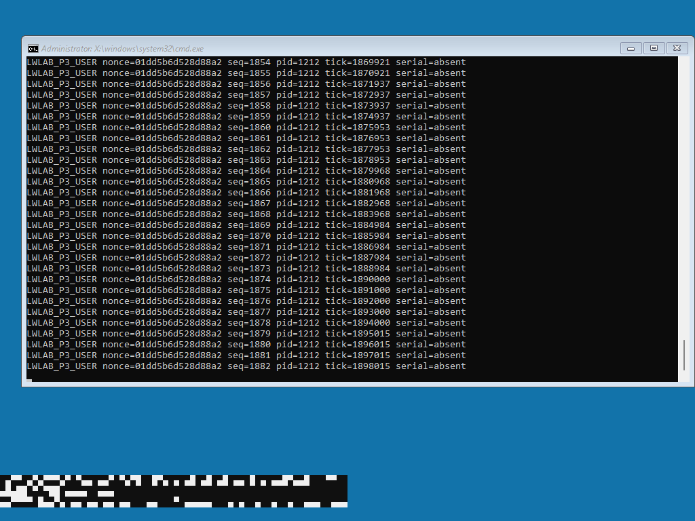

# P3：Windows 11 x64 WinPE 并行启动验收

日期：2026-10-14（Asia/Shanghai）。状态：**P3 已完成。10/10 次冷启动通过，Linux 与 WinPE 持续共存 31 分 30 秒。**

## 已实现的运行路径

在同一台 `lwlab-boot` 内，主 Linux 继续使用 CPU 0–3，CPU 4 依次运行分区 EDK2 DXE、微软 Windows Boot Manager 和 WinPE，CPU 5–7 下线。Windows 在该 AP 上作为本分区启动处理器初始化，其系统二进制没有为这个平台打补丁。启动路径没有退出 Linux，也没有在 Linux 内再创建一台 Windows 虚拟机。

外层平台仍是 QEMU/KVM + OVMF；这证明的是虚拟实验机器内的多内核共存，尚不代表裸机兼容性或性能收益。普通 `lwlab-winpe-visual` 仅用于镜像基线，未计入共存验收；其[独立启动截图](p3-evidence/winpe-baseline.png)单独保留。

核心交付见 [p3 使用说明](../p3/README.md)、[资源清单](../p3/partition.json)、[源版本](../p3/sources.lock.json)和[介质哈希](p3-media-manifest.json)。P1/P2 源文件及历史验收记录保持不变。

## 固定输入

| 项目 | 本轮输入 |
| --- | --- |
| Linux 基础 | `cangex/zero-down-time-kernel-update`，`d75950ccbae6f5f651d4a9fd0701de1819c30579` |
| Linux overlay | P1/P2 AP 机制 + P3 ABI 3、低端资源验证和 loader |
| 主内核版本 | `6.18.0-rc3-lwlab-p3` |
| EDK2 | `edk2-stable202508`，`d46aa46c8361194521391aa581593e556c707c6e` |
| 微软 add-on | `10.1.26100.9457`；固定官方下载 MSI/CAB |
| 实际 WinPE | `10.0.26100.1`，amd64，en-US |
| 介质改动 | 官方 bootmgfw_EX 启动文件；加入自编译 lwprobe.exe；startnet.cmd 启动探针 |
| VM | Q35 8.2、8 vCPU、16 GiB、两插槽/两 NUMA 节点 |
| 平台配置 | 外层 Secure Boot 关闭；分区不实现 Secure Boot；单 Windows CPU；无分区 PCI 设备 |

主内核 SHA256：`af0fa320d2f6ade5332a5d8fe800e2ffaad4cf1e6114bcaa01268b2d66d6fdc5`。

主内核配置 SHA256：`9b61a4e42a83e432e4281a93b1e1e25cdd32f2465ab660d9b2fd92c70a881bcd`。

分区固件（包含 GPT WinPE 内存盘）SHA256：`2de8a587ef854149163ccfe011bffe2ef1c012fd25b1abc12c57c022d0b3393b`。

系统版本依据原始 WIM 元数据记录；没有将 ADK 安装包版本当作 Windows build。原始微软内核、启动驱动保持原样。

## 从失败到用户态的适配依据

| 实验 | 现象与定位 | 对应修复 |
| --- | --- | --- |
| attempt01/02 | Boot Manager 的 BlInitializeLibrary 返回 `0xc00000bb`；服务 trace 显示 GetTime 不支持 | Linux 交接 UTC + 分区 TSC 提供有效 GetTime，不共享 RTC |
| attempt03，debug04/05 | ExitBootServices 后 `HAL_INITIALIZATION_FAILED 0x5c (0x8000,0xb,0,0)`；匹配微软 PDB 定位到低于 16 MiB 的 ACPI cache 分配失败 | 增加 `1..16 MiB` 独占 RAM；从 Linux 分配器移除，并验证原始 E820 RAM 类型 |
| attempt06 | 新低端区域的资源类型检查过严，sysfs 未建立，启动前检查停止 | 修正对 E820 Reserved 父资源的校验，保持禁止访问 System RAM |
| attempt07 | `0x5c (0x200,0x5250631,2,0xc000000e)`，中断控制器选择失败 | MADT 增加独占 IOAPIC，Linux 改用 `noapic` |
| attempt08 | `0x5c (0x110,0x5250631,0x15,0xc0000001)`，定时器初始化失败 | VM 启用 HPET，添加 HPET 表，Linux `hpet=disable` |
| attempt09 | `0x7e / 0xc0000005`，HAL startup stub 路径出现空地址访问 | 额外预留 `0x50000..0x6ffff`，满足低于 1 MiB 的启动区需求 |
| attempt10 | WinPE 已有 cmd.exe、lwprobe.exe 进程，屏幕未输出 | 为专属 RAM GOP 补充 DevicePath |
| attempt11 | 可见 WinPE 命令行，探针序号/tick 持续增长；COM1/COM2 打开均失败 | 使用已分配 RAM GOP 中的合作 GDI 心跳作为持续用户态证据 |
| attempt12 | 图形心跳已生成；宿主观察器读取 QEMU 运行目录时权限不足 | 用限定的 sudo cat 读取 QEMU 生成的帧缓冲文件；保留该轮失败记录，不计入正式验收 |

debug04/05 使用 QEMU/GDB 硬件断点；调试会暂停虚拟机，不能用于连续性结论。正式矩阵没有启用断点、调试门闩或暂停操作。定位使用匹配的微软 `ntkrnlmp.pdb`（GUID/age `B6CDAA3A3EF13C3B2799115B0470342B1`），并未依靠修改 Windows 指令跳过初始化错误。

主 RAM 为 1536 MiB，另有 15 MiB 和 128 KiB 两段低端 RAM。RAM GOP 使用其中已保留的 3 MiB。独立检查确认所有 HOB/SRAT 内存都来自这三段资源，FADT 不包含整机 PM/SMI/复位地址，MADT 只有分区 AP 与独占 IOAPIC，GPT 主备表 CRC 及 ESP 边界正确。

## 证据与判定

Linux 使用启动前建立的一条 TCP 连接，每秒执行文件写入、fsync、读回和 SHA256 记录。主机检查消息序号、boot ID、ping、最大间隔和内核 taint。WinPE 测试程序经 startnet/cmd 启动，每秒更新 nonce、序号、PID、tick 和 CRC32，通过 GDI 输出到独占 RAM GOP。主机每两秒采集该固定区域；CRC 错误、身份变化、倒退序号、冻结 tick、旧画面和超过 8 秒的进展间隔均不能通过。

正式判定不依赖冻结的 EFI mailbox 心跳。`firmware-ready` 仅代表固件；`stage=3 phase=21` 仅代表服务退出；最后还必须有持续 Windows 用户态心跳。截图保留了命令行窗口与程序输出，机器可读记录另外检验其进展。

矩阵要求：同一实验 VM 至少 10 次冷启动，Linux boot ID/generation 和 WinPE nonce 各自唯一，内核与固件哈希保持相同；至少一轮双系统有效观测重叠 1800 秒。单轮 Linux `result.json` 不能单独作为共存成功证据，合并结果在 `coexistence.json`。

首轮 Linux 连续观测 1904.303 秒，WinPE 有效心跳与 Linux 重叠 **1890.143 秒（31 分 30 秒）**。Linux 最大 TCP 消息间隔 1.069851 秒、ping 失败 0、taint 0；WinPE 最大进展间隔 2.059965 秒。10 轮全部通过，启动标识均独立，使用相同内核、配置和固件。完整机器可读摘要见 [验证数据](p3-validation.json)。

| 冷启动 | Linux 观测 / 秒 | 双系统重叠 / 秒 | Linux 最大间隔 / 秒 | WinPE 最大间隔 / 秒 | 结果 |
| --- | ---: | ---: | ---: | ---: | --- |
| acceptance-01 | 1904.303 | 1890.143 | 1.070 | 2.060 | 通过 |
| acceptance-02 | 94.019 | 79.994 | 1.020 | 2.049 | 通过 |
| acceptance-03 | 93.987 | 79.998 | 1.015 | 2.006 | 通过 |
| acceptance-04 | 93.996 | 79.995 | 1.009 | 2.068 | 通过 |
| acceptance-05 | 93.941 | 79.990 | 1.006 | 2.008 | 通过 |
| acceptance-06 | 94.001 | 79.998 | 1.008 | 2.019 | 通过 |
| acceptance-07 | 94.115 | 79.975 | 1.028 | 2.081 | 通过 |
| acceptance-08 | 93.910 | 79.988 | 1.007 | 2.015 | 通过 |
| acceptance-09 | 93.948 | 79.997 | 1.015 | 2.075 | 通过 |
| acceptance-10 | 94.099 | 79.988 | 1.020 | 2.014 | 通过 |

所有轮次均为 ping 失败 0、kernel taint 0、TCP 连接无重连。12 项心跳解析/拒绝测试通过，覆盖黑屏、截断、CRC 错误、撕裂像素、旧帧、身份变化、序号倒退、冻结 tick、长间隙和不足观测时间。

截图来自 AP 分区专用 RAM GOP；窗口中的序号已增长至 1882。图像仅提供可视证据，连续性判定使用完整 JSON 流。

## 可复现产物与边界

宿主机 `/data/linux-window-lab/artifacts/p3/` 保存所有 attempt/debug/acceptance 记录。正式产物包为 `package-final/`；`acceptance-01..10/` 包含 Linux 流、WinPE 流、截图、UEFI 串口、dmesg、中断快照、QEMU 寄存器、VM XML 和哈希。`baselines/pre-p3/` 保留启动前 idle P2 的磁盘、NVRAM 和 XML 冷备份。

源码重新从固定 Linux 归档应用仓库 overlay 后，与实际构建源码逐文件比较一致。干净源码的完整内核/模块构建通过，生成配置与正式内核一致，见 [构建验证](p3-build-validation.json)。构建配置和所有正式镜像哈希被单独冻结。构建生成的 PE/WIM/内核含时间等元数据，本项目记录具体产物哈希，不承诺每次重新构建按位相同。

本轮只验收**单 AP 的 WinPE 启动与共存**。以下仍未验收：Windows 多核启动、裸机迁移、完整 Windows 安装与独占设备、交互输入设备、Windows 独立复位/关机/资源回收、长期压力与性能对照。

GDI 心跳是合作存活遥测，数据由宿主 QMP 采集，不能作为 P4 已完成的证明。下一阶段需要在 Linux 内实现限定分区范围的只读后端，对已知缓冲区验证读取、一致性和失效 generation；任意 Windows 对象定位与解析继续留在后续阶段。
